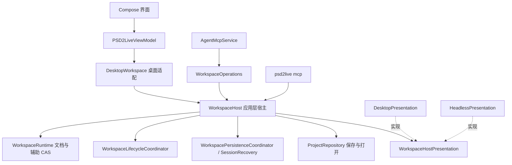

# 无窗口宿主

[文档目录](../../README.md) · [智能体设计](../agent/AGENT_DESIGN.md) · [MCP 编写操作](../agent/MCP_AUTHORING.md) · [素材与 Layout](MATERIAL_LAYOUT_WORKSPACE.md)

工作区的应用逻辑在不依赖界面的 `application.WorkspaceHost` 中，桌面编辑器与无窗口 MCP（`psd2live mcp`）是它的两个宿主：编辑器把结果投影进 Compose 状态，无窗口宿主不显示任何东西。本页记录结构、两个宿主的差别与验收；"已实现"与"待做"分开列出。

## 为什么需要无窗口宿主

无窗口模式是智能体与外部生成工具协作的主通道：外部工具（图像生成、抠图、分割）只产出像素，裁特写、摆放、纹理密度、分类、生成 Rig、检查姿态和导出都在 PSD2Live 内完成。参见 [素材与 Layout](MATERIAL_LAYOUT_WORKSPACE.md) 的"按参考图拆件"与"剥离"：特写按画布矩形放回时不重采样，部件的清晰度就是特写的放大倍数，这一点只有在程序内排版才能保证。

此前 `psd2live mcp` 把桌面应用的 `PSD2LiveViewModel` 与 `DesktopWorkspace` 原样建起来、只是不显示窗口：提交要经过界面副本的二次 CAS，忙碌与未保存读界面字段，生命周期挂在 ViewModel 上，动作采样等主窗口的 GPU 上下文而超时。

## 结构（已实现）

- **`WorkspaceHost<V>`**（`application/WorkspaceHost.kt`）实现 `WorkspaceBackend`：持有运行时、全部命令对象、草稿队列、持久化与恢复检查点（`SessionRecovery`）、工程归档的打开与保存（原 `ProjectController`）。`V` 是宿主自己的展示快照类型，操作开始时捕获，通知时交回，宿主据此判断展示是否已经变化。
- **`WorkspaceHostPresentation<V>`**（`application/WorkspaceHostPresentation.kt`）是宿主看到的全部界面：
  - 读：`current` / `withCurrent`、`facts`（忙碌、未保存、当前工作区、画布地址、展示字段，见 `WorkspaceHostFacts`）、`visibleLayers`、`auxiliary`、`config`、`basis`；宿主不读展示中的文档；
  - 投影：`show`（提交内把结果交给展示，展示把自己的字段草稿变基到它之上，从不拒绝提交，见下文"运行时唯一权威"）、`draftYielded`（排队草稿的字段让给了别的提交）、`savedView`（保存后展示应有的样子，作为脏标记的基线），以及历史、模型、姿态、播放帧、摆动与模拟预览、画布可见性、导入与安装、保存进度等通知；
  - 归档展示：`encode` / `decode` 把展示部分（布局、镜头、画布）与归档 JSON 互转；
  - 其他：`simulationBake`、`sampleMotion`、`importedSource`（编辑器自行分析的 PSD）。
- **`DesktopWorkspace`** 是编辑器的薄适配：用 `DesktopPresentation` 包装 ViewModel 构造宿主，转发编辑器与测试需要的内部入口。编辑器状态里的文档字段是运行时文档的投影加字段草稿，草稿经 `WorkspaceDraftQueue` 提交。
- **`HeadlessPresentation`** 是无窗口展示：不持有草稿，`show` 与其他通知全部为空；只记录查询要报告的工程 ID、来源、保存路径，未保存取运行时的 `hasUnsavedChanges`；归档中的展示 JSON 原样往返；动作采样用不依赖窗口的 Cubism 会话（`CubismSdkPreviewSession.windowless`，`ThreadGpuExecutor`）。
- **`psd2live mcp`**（`HeadlessMcp`）设 `java.awt.headless=true`，构造 `WorkspaceHost(HeadlessPresentation)` + `WorkspaceOperations` + `AgentMcpService`，不创建 ViewModel、Compose 状态或窗口。一个进程一个工程，需要并行时起多个进程，各用自己的 `--store`。启动时除 `endpoint`、`token`、`profile`、`store` 外打印 `capabilities`，目前为 `view_sample_motion=yes|no`（构建是否带 Cubism Core）。

### 两个宿主的差别

| 方面 | 桌面 | 无窗口 |
| --- | --- | --- |
| 文档字段 | 运行时文档的投影加字段草稿，草稿经草稿队列提交 | 无，运行时文档即展示 |
| 新来源的初始设置 | 编辑器当前设置 | `PipelineConfig()`，与编辑器默认相同（测试固定） |
| 工作区与画布 | 编辑器的标签页与画布 | 固定一个工作区 `main`，无画布 |
| 保存路径 | 生命周期记录或编辑器状态 | 生命周期记录或最近一次保存 / 打开的路径 |
| 动作采样 | 主窗口的 Cubism 会话 | 独立线程的无窗口会话 |
| 进度 | 状态栏；模拟烘焙另有编辑器的烘焙条 | 进程任务自身的进度 |

## 运行时唯一权威（已实现）

运行时（`WorkspaceRuntime`）是文档的唯一权威，编辑器状态里的文档字段只是**字段草稿**：未改动的字段始终是运行时文档的投影，改动过的字段等待经 `WorkspaceDraftQueue` 提交。任何提交都不会因为编辑器"显示着别的东西"而被拒绝。

### 规则

- **投影即变基**：宿主在提交内调用 `WorkspaceHostPresentation.show(view, preview, base, next, …)`，不再返回布尔值。`base` 是展示中"未改动字段"应当等于的文档：外部提交（MCP、命令）为提交前的运行时文档，编辑器自己的草稿为提交时送出的草稿文档。展示按字段三方合并 `WorkspaceDraftRebase.rebase(base, draft, next)`：
  - 草稿字段等于 `base` → 取 `next`；`next` 等于 `base` → 保留草稿；两者相同 → 取 `next`；
  - 映射类字段（图层可见、覆盖、父级、网格覆盖、纹理覆盖）与设置 JSON 逐键合并；
  - `rigEdits` 若双方只在 `authoringJournal` 上追加，草稿追加的命令接在 `next` 的日志之后（命令级变基，等同草稿晚于外部编辑执行）；
  - 其余双方都改的字段为**冲突**：运行时取胜，丢弃该字段的草稿并在编辑器日志里警告。
- **检出替换**：撤销、重做、分支切换（`checkoutHistory`）传 `base = null`，展示整体换成检出的文档，未提交的草稿丢弃并在日志里警告（与上一次展示的提交比较；工程刚打开、还未展示过提交时与检出的文档比较）。编辑器字段会话里待重放的设置切换、让出与被改过的设置键、待记录的对象编辑在同一次状态更新里清掉，不必等宿主随后丢弃草稿队列（`discardDrafts`），因此检出发布之后才结束的字段也不会把切换重放到检出后的文档上。
- **草稿的提交起点**：编辑器在提交草稿时（而不是字段会话开始时）于状态锁内读取草稿文档、**最近一次展示的提交文档**（`origin`，即草稿未改动字段所镜像的运行时文档）与运行时状态令牌，一起作为 `WorkspaceEditorDraft` 提交。`origin` 在每次 `show` 时更新，打开工程、导入新来源和替换导入时也换成装入的文档。运行时在锁内先 `show` 后发布状态，发布不在编辑器的状态锁内，所以读到的令牌可能早于 `origin` 那次提交；令牌只作首次 CAS 的期望，冲突时队列以 `origin` 为基准把草稿带到当前状态，草稿缺少外部编辑却带着新令牌的情形不会发生（`origin` 总不旧于草稿所见）。旧的会话开始快照 `editorDraftExpected` 删除。
- **草稿队列变基重试**（让出的设置键在准备候选时连同它的设置切换整体撤回，切换派生的键与释放的姿态也就不会落地）：队列中的草稿在执行时若遇到外部提交造成的 `WorkspaceConflict`，以 `origin`（或同一状态下的运行时文档）为 `base`、当前运行时文档为 `next` 变基草稿，按新状态重试；与展示同一规则，双方都改的字段取运行时的值，其余照常提交，让出的字段经 `draftYielded` 在编辑器日志里警告。只有连续被超过 `MAX_REBASES` 次，或不知道 `origin` 时才拒绝；拒绝后的修复也走 `show`（`base` = 被拒草稿），只撤回草稿之后未再改动的字段。
- **保存不回写**：`captureProject` 不再把编辑器版本的文档作为 "Save project" 节点提交进运行时；保存前照旧结束字段会话、等待草稿队列，然后只保存运行时的捕获。保存的脏标记基线是 `savedView`：编辑器状态换上所保存捕获的文档字段，因此编辑器仍草拟着而运行时没有的字段保存后依旧为脏，关闭时会提示。`checkpoint` 仍对运行时文档强制追加节点。`WorkspaceHostPresentation.document` 删除，宿主不再读取展示中的文档。

### 提交与保存时机的变化

| 情形 | 此前 | 现在 |
| --- | --- | --- |
| 字段会话进行中，MCP 修改了别的字段 | MCP 提交被拒（"Workspace changed while the operation was being built"） | MCP 提交成功；编辑器保留草稿字段，会话结束时在新状态上提交 |
| 字段会话进行中，MCP 修改了同一字段 | MCP 提交被拒 | MCP 提交成功；该字段草稿丢弃并警告 |
| 草稿已入队未提交，MCP 先提交 | 草稿 CAS 冲突被拒，编辑器回退 | 草稿变基后重试；同字段取运行时的值并警告，其余字段照常提交 |
| 保存时编辑器有未经草稿提交的字段 | 作为 "Save project" 节点提交后保存 | 不提交；只保存运行时文档，工程保持为脏 |
| MCP 撤销 / 检出时编辑器有草稿 | 检出被拒 | 检出成功，草稿丢弃并警告 |

字段会话中的设置切换（`editorSettingsIntents`）随草稿按命令重放。重放会派生别的键（如 `meshOnly` 派生 `generateDeformers`、动作开关派生 `exportMotions`），而布尔派生键在字段比较中可能根本不构成冲突，因此编辑器记录两类让出的设置键，随草稿交给队列（`yieldedSettings`），重放之后这些键恢复为运行时的值：投影判定为冲突的键（同时从切换中移除），以及会话期间被别的提交改过的键。两类都只在会话持有待重放的切换时记录，每个会话开始时清空，提交时只保留编辑器之后没有再改的键（草稿中的值仍等于 `origin`）——用户让出后又亲手改回的值照常提交。草稿预览（`schedulePreviewRebuild`）构建期间若有提交落地，预览以 `WorkspaceConflict` 结束而不报错，展示该提交时若仍有草稿字段会重新安排预览。

风险：若仍有编辑器路径只改状态字段而不经 `editorChanged` / 命令提交（"幽灵草稿"），此前会被保存"兜底"提交，现在不会进入工程，但工程保持为脏；这类路径应视为缺陷，结束时还原或改为草稿提交。已修正的来源：动作关键帧拖动结束时总是还原为已提交的片段；删除变形器不再在本地删除旧 v1 父级覆盖（由日志里的删除命令负责）。

动作关键帧拖动与字段草稿同一规则：拖动期间别的作者提交了，若被拖动的片段在已提交文档里仍是拖动开始时的样子，拖动按当前状态提交；片段被改过则拖动让出并警告。拖动结束时读到的状态可能早于已展示的提交，提交冲突时按冲突给出的状态再判断片段并重试（`MOTION_DRAG_REBASES`）；拖动是否提交只看它是否产生过拖动请求，展示提交时被冲突换掉的拖动预览不影响。

字段草稿的提交在一段状态锁内取走会话（切换、让出与被改过的设置键、效果）并读取草稿与 `origin`，两者之间不会有提交插入。每个设置切换的预览效果（触发动作、重置物理等）与它的改动成对保存，切换因让出被整体撤回时效果也不执行。

模拟烘焙的进度与取消对两个宿主相同：命令用 `WorkspaceSimulationWork.cancellable` 把进度报给运行它的进程任务（`WorkspaceJobContext`）并随任务取消而停止；`simulationBake` 只是展示的观察入口，桌面用它显示烘焙条与取消按钮，无窗口为空。

## 外部工具的接入方式

外部脚本只做程序做不到的事（调用图像生成服务、外部抠图模型），并且只通过 MCP 与程序交换像素：

1. `material_crop`（`canvas_rect`）截特写 → `material_export_png` 交给外部；
2. 外部输出高分辨率图片 → `material_import` → `material_set_placement`（`from` 特写）→ 逐层 `material_peel` → `layer_place`；
3. 对齐、密度、分类、生成、姿态检查、导出都用程序内的操作。

外部代码因此不再需要自写 PSD、按画布重采样、拼贴合成、自己画对比图。仍在外部的只有生成服务的客户端与工作流（不在主线，见 `comfy-tools` 分支）。脚本用随程序发布的 `mcp_proxy.py`（`Client`，或 `call` / `operations` 命令行模式）调用操作。

## 待做

- **草稿收窄**：编辑器状态仍保存全部文档字段作为草稿载体，提交时整份送出再按字段变基；可改为只记录改动过的字段，届时 `WorkspaceStateCodec.document` 只在导入新来源时使用。

## 验收

- `LayerDependencyTest`：`application`、`agent`、`project`、`core`、`history` 包与 `HeadlessMcp` 不引用 `ui` 与 Compose。
- `HeadlessHostScenario`：
  - 无窗口宿主经 MCP 完成新建 Layout 工程、导入、参考图、裁特写、放置、标签、生成、带参考差值的渲染、另存、保存、重开与导出；
  - 同一组调用在桌面宿主与无窗口宿主上得到相同的文档修订；
  - 无窗口的默认设置与编辑器默认相同。
- 实测：`psd2live mcp` 进程经 `mcp_proxy.py` 的 `Client` 跑通 Layout 与剥离流程，`view_sample_motion` 在无窗口时约 1 秒返回采样拼图。
- 编辑器场景（`SaveAndCloseTest`、`EditorAndAgentScenario` 等）与全部测试通过，其中：
  - `EditorDraftRebaseTest`：字段变基、映射与设置逐键合并、日志追加的命令级变基、同字段冲突；草稿队列中的草稿越过外部提交后重试，同字段让给运行时、其余照常提交；在外部提交发布状态之前读取的草稿凭 `origin` 落地（无 `origin` 时被拒）；
  - `EditorAndAgentScenario.anAgentEditDuringAnOpenFieldLandsAndTheFieldCommitsOverIt`：字段会话中的 MCP 提交成功、草稿保留并在其上提交；同一设置被 MCP 修改时草稿让步；
  - `EditorAndAgentScenario.savingRecordsTheRuntimeAndNotTheEditorsCopy`：保存不追加修订，也不把未提交的编辑器字段写进归档，工程保持为脏；
  - `SaveAndCloseTest.aGestureOverAnExternalCommit…`：越过外部提交的手势正常提交、同设置让步，之后的保存不再脏；
  - `SaveAndCloseTest.aSettingYieldedInAFieldKeepsTheAgentsValueWhereASwitchWouldDeriveIt`：会话中的派生键保留智能体写的值；
  - `SaveAndCloseTest.aCheckoutDiscardingAFieldWarnsAndForgetsItsSwitches`：检出丢弃草稿时警告，会话结束不再把切换重放到检出后的文档；
  - `SaveAndCloseTest.deletingADeformerLeavesNoDraftBehind`、`aMotionKeyDragOvertakenByAnAgentCommitLeavesNoDraftBehind`：这两条路径结束后编辑器只显示运行时文档，被未改动片段的提交超过的拖动照常提交；
  - `SaveAndCloseTest.aFieldClosingBetweenACommitsShowAndItsPublicationStillLands`：用运行时的测试钩子让字段恰在提交已展示、尚未发布时读取状态，并在发布之后才入队，草稿凭 `origin` 落地；
  - `SaveAndCloseTest.aYieldedSwitchLeavesOutWhatItDoesToThePreview`、`aMotionKeyDragEndingBeforeACommitsPublicationFollowsIt`：让出的切换不触发预览效果；在提交发布前结束、带旧状态的拖动跟上该提交后落地；
  - `SaveAndCloseTest.aValueTheEditorTakesBackAfterYieldingItIsCommitted`、`aReplacingImportIsWhatTheEditorMirrorsAfterwards`、`aCheckoutRightAfterOpeningDiscardsAFieldWithAWarning`、`aReplacingShowEndsTheSessionsSwitchesBeforeTheHostDiscardsItsQueues`：让出后改回的值、替换导入后的镜像文档、打开后立即检出的警告、检出展示时即清空会话；
  - `HeadlessSimulationBakeTest`：无窗口烘焙向进程任务报告进度，任务取消即停止。
