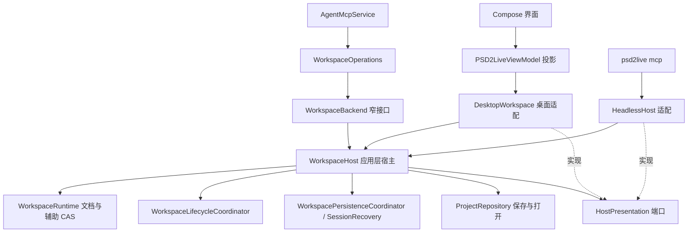

# 无窗口宿主

[文档目录](../../README.md) · [智能体设计](../agent/AGENT_DESIGN.md) · [MCP 编写操作](../agent/MCP_AUTHORING.md) · [素材与 Layout](MATERIAL_LAYOUT_WORKSPACE.md)

本页是**设计稿**。`psd2live mcp` 已经能不开窗口提供 MCP 端点，但它是把桌面应用的 `PSD2LiveViewModel` 与 `DesktopWorkspace` 原样建起来、只是不显示窗口。本页把无窗口运行定为正式架构：应用层有一个不依赖界面的工作区宿主，桌面编辑器和无窗口 MCP 是它的两个适配。

## 为什么要正式化

无窗口模式是智能体与外部生成工具协作的主通道：外部工具（图像生成、抠图、分割）只产出像素，裁特写、摆放、纹理密度、分类、生成 Rig、检查姿态和导出都在 PSD2Live 内完成。参见 [素材与 Layout](MATERIAL_LAYOUT_WORKSPACE.md) 的"按参考图拆件"流程：特写按画布矩形放回时不重采样，部件的清晰度就是特写的放大倍数，这一点只有在程序内排版才能保证。

现状的问题：

- **界面状态是权威之一。** `DesktopWorkspace` 每次提交在 `beforeCommit` 里把结果投影进 `PSD2LiveState` 并对界面副本再做一次 CAS（`applyAgentWorkspacePreview`）；保存时以 `WorkspaceStateCodec.document(ui)` 为准，界面与运行时不一致时先提交界面版本。无窗口时这些都在空转，却仍决定成败。
- **忙碌与未保存判断读界面字段**：`isAnalyzing`、`isGenerating`、`projectDirty`、`projectSaving`、`canvasEditBusy` 等约 30 处。
- **生命周期挂在 ViewModel 上**：`WorkspaceLifecycleCoordinator` 由 ViewModel 创建，`ProjectController` 通过 ViewModel 报告保存进度。
- **动作采样依赖主窗口的 GPU 上下文**：`view_sample_motion` 经 `CubismSdkPreviewSession` 走 `PrimaryGpuExecutor`，没有窗口时等到超时。其余视图（`view_render_model`、`view_render_poses` 等）已经是纯 CPU 渲染。
- **没有回归测试覆盖 `psd2live mcp` 本身。**

已经中立、可以直接复用的部分：`agent/*` 与 `WorkspaceOperations` 只依赖 `WorkspaceBackend`；`WorkspaceRuntime`、各 `Workspace*Commands`、`WorkspacePersistenceCoordinator`、`WorkspaceLifecycleCoordinator`、`WorkspaceQueryPresentation`、`WorkspaceMotionSampler`、`WorkspaceSimulationWork` 都在应用层；测试里的 `Studio` 已经不经 ViewModel 驱动运行时完成导入、编辑、撤销、保存与导出。

## 结构

### WorkspaceHost（应用层）

把 `DesktopWorkspace` 中与界面无关的部分移到 `application.WorkspaceHost : WorkspaceBackend`：

- 持有 `WorkspaceRuntime`、命令对象、草稿队列、持久化协调器、生命周期协调器、恢复检查点（`SessionRecovery` 移出 `ui.state`，它本身只用文件与 JSON）。
- 所有修改走同一个提交模板：捕获 → 忙碌检查 → 纯候选执行 → 运行时 CAS → 通知端口 → 安排持久化。现在散落在约 30 个方法里的"`captureForMutation` + 守卫 + `beforeCommit` + `updateHistorySnapshot` + `refreshWorkspaceRenderer`"收成一个辅助函数。
- **运行时文档是唯一权威。** 保存、检查点、导出读取 `runtime.capture()`；界面不能再提交"界面版本的文档"。界面的字段草稿照旧经 `WorkspaceDraftQueue` 先提交，再保存。
- 包内不得引用 `io.github.psd2live.ui` 与 Compose；用架构测试固定这条依赖方向。

### 宿主端口

宿主通过少量注入端口与界面交互，无窗口宿主全部给默认实现：

| 端口 | 职责 | 桌面实现 | 无窗口实现 |
| --- | --- | --- | --- |
| `HostActivity` | 宿主自身之外的忙碌（分析、生成中的界面任务、画布手势）与未进入运行时的未保存内容 | 读 `PSD2LiveState` | 只看运行时与自身任务 |
| `HostSessionContext` | 当前工作区 ID、工作区列表、画布地址、播放默认值（鼠标跟踪等） | 读界面标签页与画布 | 固定一个工作区 `main` 与默认画布 |
| `HostQueryPresentation` | `WorkspaceQueryPresentation` 中的展示字段（来源名、工程文件、状态文本、选中图层） | 读界面 | 来自工程与宿主自身记录 |
| `HostPresentation` | 提交后的通知：历史快照、模型发布（刷新预览渲染器）、姿态与播放帧、摆动与模拟预览、画布可见性、导入安装、辅助数据变化 | 投影进 ViewModel | 空实现 |
| `HostPresentationStore` | 归档中的界面展示部分（布局、镜头、画布）以不透明 JSON 往返 | `WorkspaceStateCodec` 编解码 | 原样保留读到的 JSON；新工程为空 |
| `WorkspaceSimulationWork` | 模拟烘焙的进度与取消 | 界面进度条与取消按钮 | 接到进程任务的进度与取消 |
| `WorkspaceMotionSampler` | 动作采样 | 主窗口的 Cubism SDK 会话 | `ThreadGpuExecutor` 上的独立会话，不可用时用 CPU 求值器 |

`HostPresentation` 是观察者，不能拒绝提交；界面副本上的二次 CAS 取消。界面在通知里比较捕获版本，过时的通知丢弃。

### DesktopWorkspace（桌面适配）

变成薄适配器：构造 `WorkspaceHost`，用 ViewModel 实现上面的端口，保留只属于编辑器的部分——字段草稿的提交入口、纹理编辑队列、Cubism 实时预览的激活。`ProjectController` 的进度与状态改为监听宿主的保存 / 打开事件。

### 无窗口宿主

`psd2live mcp` 改为：

- 以 `-Djava.awt.headless=true` 运行，不初始化 Skia 窗口上下文；
- 构造 `WorkspaceHost` + 无窗口端口 + `WorkspaceOperations` + `AgentMcpService`；
- 一个进程一个工程；需要并行处理多个工程时起多个进程，各用自己的 `--store`；
- 启动时打印 `endpoint`、`token`、`profile`、`store`（不变），另打印 `capabilities`（是否有动作采样等），供客户端判断。

## 外部工具的接入方式

外部脚本只做程序做不到的事（调用图像生成服务、外部抠图模型），并且只通过 MCP 与程序交换像素：

1. `material_crop`（`canvas_rect`）截特写 → `material_export_png` 交给外部；
2. 外部输出高分辨率部件 PNG → `material_import` → `layer_place`（`rect` 为特写的画布矩形）；
3. 对齐、密度、分类、生成、姿态检查、导出都用程序内的操作。

由此，外部代码不再需要：自写 PSD、按画布重采样、拼贴合成、自己画对比图。仍在外部的只有生成服务的客户端与工作流（`tools/comfy`）。程序侧已经补上：

- **正式客户端**：`mcp_proxy.py` 除 Stdio 代理外提供 `Client` 与 `call` / `operations` 命令行模式，随程序发布，取代各流程各写一份的客户端。
- **剥离合成**：`material_peel` 与 `material_set_placement`（见 [素材与 Layout](MATERIAL_LAYOUT_WORKSPACE.md) 的"剥离"），外部只负责出图。

## 实施顺序

1. **测试先行**：基于现有 `EditorAndAgentScenario` 的接线写无窗口回归场景——新建 Layout 工程、导入、裁特写、放置、标签、生成、渲染、保存、重开、导出，作为整个重构的验收基线。
2. **抽出 WorkspaceHost**：移动纯应用逻辑与提交模板，`DesktopWorkspace` 先以全部端口委托 ViewModel 的方式保持行为不变；删除未用的 `ui.BoneHit`、`ui.SkeletonPoseTool` 导入。
3. **权威收归运行时**：去掉界面副本 CAS 与"保存时提交界面文档"，展示 JSON 改为不透明往返。
4. **无窗口端口与入口**：`HeadlessHost`、无窗口动作采样、`java.awt.headless`、`capabilities` 输出；`psd2live mcp` 不再构造 ViewModel。
5. **文档**：`MCP_AUTHORING.md` 与 `DEVELOPMENT.md` 改写无窗口用法。

## 验收

- `application` 包不引用 `ui` 与 Compose（架构测试）。
- 无窗口回归场景完成全流程；同一操作序列在桌面适配与无窗口宿主上得到相同的文档修订与导出摘要。
- `view_sample_motion` 在无窗口时可用，或在 `capabilities` 中如实报告不可用并返回明确错误，而不是超时。
- 现有 `SaveAndCloseTest`、`EditorAndAgentScenario` 等编辑器场景不变通过。
