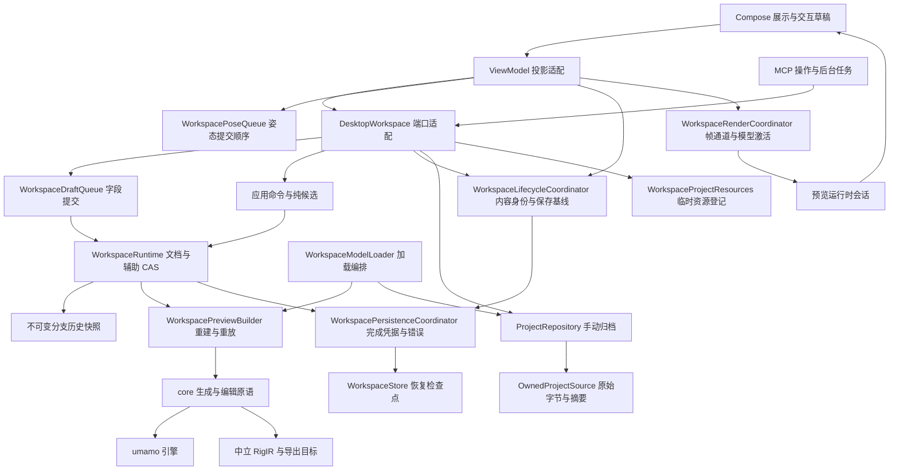
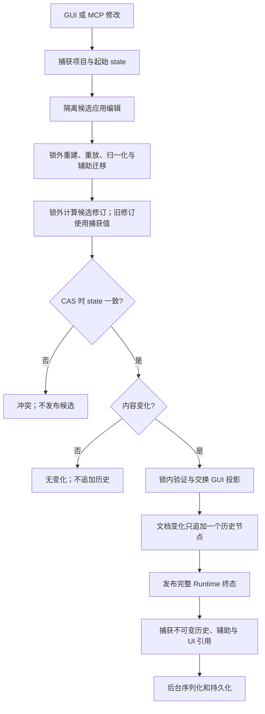
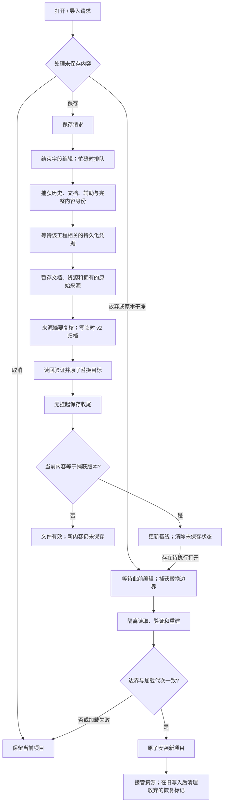
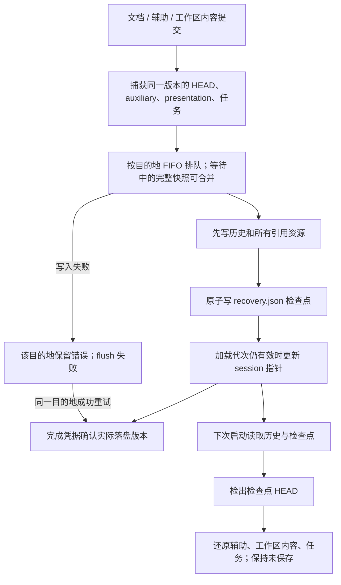
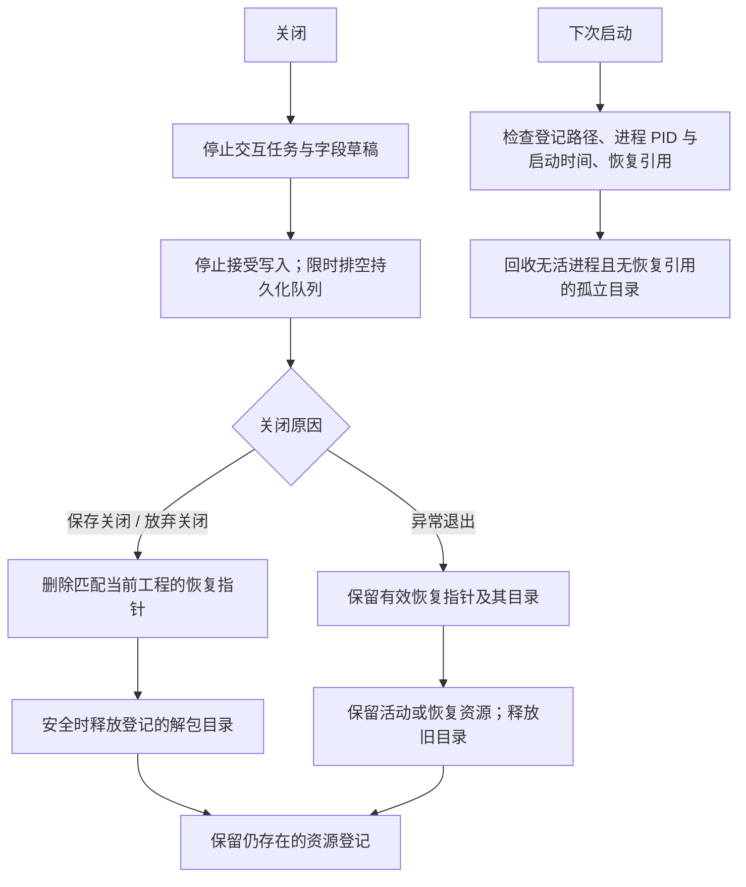

# 工作区架构审查与优化验收

审查日期：2026-10-13。审查基线包含保存修复 `9361d836`；实现与导出对比基线为 `d61c89e1`。本页记录 R1–R8 的落实情况、当前链路与验证边界。

## 1. 当前职责边界

文档和持久辅助数据由 `WorkspaceRuntime` 管理；模型是该捕获版本的派生结果。应用层生命周期协调器保存完整内容身份、保存基线、保存路径和任务记录。界面提供工作区内容的不可变投影，继续沿用归档 presentation 字段以兼容旧工程。

`project` 不依赖 application、UI 或 Compose；`core.ExportService` 不再导入应用层重建器。读取工程 / PSD 后重建的编排移入 `application.WorkspaceModelLoader`，CLI 与开发工具使用同一入口。中立 IR 与引擎的模块、许可证边界未改变。

## 2. 数据与版本

| 数据 | 所有者 | 保存 / 恢复 |
| --- | --- | --- |
| 源图、设置、Rig 日志、网格及图层覆盖 | Runtime 文档 | 分支历史、归档、恢复检查点引用的 HEAD |
| 姿态、锁定、快照、注释、素材目录 | Runtime auxiliary；UI 为投影 | 辅助 CAS；完整恢复检查点和归档 |
| 输出目录、工作区结构与画布可见性 | UI 输入 → 应用层 DurableIdentity | 内容版本和保存基线；恢复 presentation、归档 |
| 保存路径、保存基线、任务记录 | LifecycleCoordinator | 捕获版本；任务归档和恢复，不自动重启任务 |
| 原始 PSD / CMO3 字节 | OwnedProjectSource | 导入时捕获；以格式和 SHA-256 定址；归档复核摘要 |
| 镜头、焦点、选择、布局、展示选项 | UI / 画布会话 | 手动归档可记录；变化不要求保存 |
| 播放、跟踪、物理 / 模拟输出、渲染帧 | 进程预览会话和 RenderCoordinator | 临时数据，不进保存身份或历史 |

文档修订、Runtime state、加载代次和完整内容版本各有职责。保存完成只更新匹配项目与加载代次的基线；写盘期间的新内容继续显示未保存。纯展示更新复用同一个内容身份，不增加完整内容版本。

## 3. 编辑与提交

修订哈希不占用提交锁，旧文档不再重新哈希。历史选择使用不可变的 64 项页和短尾部，捕获不复制完整列表。恢复的 JSON 序列化放在后台写任务中。GUI 投影的最终验证与交换仍留在 CAS 临界区：它必须在权威历史改变之前失败，保证没有部分提交；本次没有把这项约束换成跨锁的非原子发布。

姿态队列只追踪自己的提交后继，后续手势跟随此前排队的姿态提交；外部修改仍触发 Runtime CAS 冲突。投影已提交姿态时保留更晚的待提交值，并按工作区和加载代次隔离。实时帧不进入姿态队列。

## 4. 保存和项目替换

导入先复制原始字节，再从工作区拥有的文件解析。保存读取这份副本，外部文件移动、删除或改写不影响保存。打开归档时接管解包后的来源并核对描述符；旧工程没有描述符仍可打开。没有原始文件的生成工程继续从根历史源图生成 PSD；已有 CMO3 导入载荷继续保存在文档中。

## 5. 完整恢复与落盘结果

恢复检查点 schema 为 1，独立于归档 v2。历史先落盘，检查点后交换，因此旧检查点不会引用未写入的新节点。旧工作目录没有检查点时回退到原有历史恢复。观察资源的成功写入不会清除恢复写入错误；flush 只等待对应工程的关键凭据。合并快照的旧凭据确认覆盖它的较新完整版本，而不是凭排队完成宣称落盘成功。取消会结束所有未确认凭据。

## 6. 关闭和临时资源

只删除显式登记、位于系统临时根目录下且符合解包命名约定的目录；不扫描任意临时目录。恢复目录和其他活进程资源受到保护。重复关闭与重复删除是幂等操作；排空超时不会在仍可能写入时删除目录，未释放登记留给后续回收。

## 7. R1–R8 落实结果

| 项目 | 落实 | 证据 |
| --- | --- | --- |
| R1 完整恢复 | 文档、辅助、工作区内容、任务统一检查点 | 辅助独立编辑 → 新会话恢复 → 保存重开回归；辅助变化不新增历史 |
| R2 原始来源所有权 | 按摘要捕获原始 PSD / CMO3，保存和打开复核 | 外部改写 / 删除后保存；归档原始字节和重建模型一致 |
| R3 完成凭据与错误 | 分目的地确认、完整快照合并、失败重试与取消 | PersistenceCoordinator 回归 |
| R4 关闭与回收 | 显式关闭原因、限时排空、受保护的资源登记与回收 | 放弃退出 / 异常恢复、重复关闭、孤立 / 活进程 / 未登记资源回归 |
| R5 生命周期所有权 | 应用层 DurableState、SavedVersion、保存路径与任务记录 | 原有 GUI / MCP、放弃、并发和迟到取消回归 |
| R6 提交锁与历史 | 锁外哈希、复用旧修订、历史共享页、后台序列化 | 哈希阻塞时读取与辅助 CAS 不阻塞；旧候选最终冲突；历史快照不可变 |
| R7 展示身份复用 | 无内容变化时共享身份与内容版本 | 镜头 / 焦点 / 播放等不触发保存状态；合成分配测量 |
| R8 职责拆分 | Lifecycle、Persistence、Pose、Render 协调器；应用层 ModelLoader | 队列 / 帧通道回归、加载与导出一致性检查 |

## 8. 实测与边界

- 全量 `gradlew test` 通过，保存 / 关闭场景 33 项通过；另有持久化凭据、原始来源、资源回收、Runtime 并发、历史共享页、姿态队列和渲染通道回归。测试日志位于 `build/optimization-full-test.log`。
- 导出金样本共 180 项：174 项文件 / CMO3 读回摘要一致；6 项 CAN3 在按配套 CMO3 部件 ID 解析随机 GUID 引用后，完整 XML 一致。没有修改导出格式逻辑。结果为 `build/tools/export-golden/comparison.txt`。
- `WorkspaceLifecyclePerfTool` 使用 20,000 节点历史、20 个工作区各 4 个画布。200 次历史捕获的分配从约 112 MB 降至约 6 KB；2,000 次纯展示身份刷新从约 41 MB 降至约 1.8 MB。具体耗时与字节数见 `build/tools/workspace-lifecycle/performance.txt`。这是合成分配对比，不是渲染帧率或真实项目延迟承诺。
- 实际 OpenGL / P2LRT 预览工具通过；本机公开示例播放 3 秒记录 706 帧，暂停截图已检查，模型与界面正常显示。结果为 `build/tools/preview-fps/report.txt`、`p2lrt-paused.png`；该帧数只作为本机渲染链路通路证据，不作重构前后帧率对比。工具采用应用层导入 / 打开，绕过交互确认并在结束时关闭资源。
- 提交锁内保留原子投影验证；持久工作区内容仍从 UI 兼容字段投影为应用层值。这两个边界明确保留，以免改变现有原子提交和归档契约。未来新增字段须进入 DurableIdentity、检查点 codec 和归档 codec，临时帧须继续保持独立。
